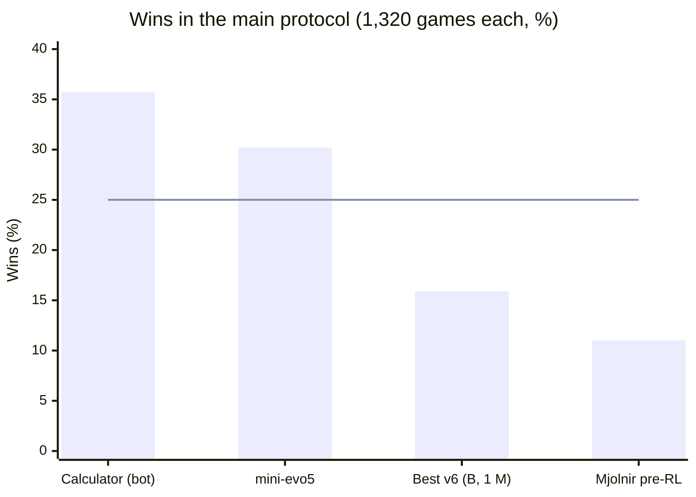

# Rentcraft

**An open research log on teaching small neural networks to play a Monopoly-style board game, including the
hardest part: negotiating trades with other players.**

Rentcraft is a **Monopoly-style board game** written from scratch as a research testbed for game-playing AI. Humans,
rule-based bots, AI agents (connected over MCP, the Model Context Protocol, or a REST API) and our own
reinforcement-learning (RL) models can all sit at the same table, in any mix of two to four players. Our networks are
small: the MLPs (32x32) have about 31,000-42,000 parameters, depending on their input, and the transformers about
0.09-1.3 million.

This repository holds the **public write-ups** of the project: what we tried, what worked, what did not, and the
numbers behind it. The game itself (without the training tooling) is planned to be published here later.

**Start here:** the [In short](journal/01-from-rule-bots-to-v7.md#in-short) summary at the top of the first journal
entry.

| File | What is in it |
|---|---|
| [journal/01-from-rule-bots-to-v7.md](journal/01-from-rule-bots-to-v7.md) | Research journal, entry 1: everything from the first bots to encoder v7, with all numbers |
| [bots.md](bots.md) | Our rule-based bots: rules, origin and measured strength |
| [rules.md](rules.md) | The game rules: simplifications and our own decisions where the official rules are silent |
| [glossary.md](glossary.md) | Terms, every model with its result, and how we measure |
| [lineage.md](lineage.md) | Which model was trained from which |
| [related-work.md](related-work.md) | Earlier work on the game and the closest related methods |
| [CITATION.cff](CITATION.cff), [LICENSE](LICENSE) | How to cite these texts, and their license |

## Rentcraft and Monopoly

**Monopoly is a trademark of Hasbro.** Rentcraft is an independent research project and is not affiliated with,
sponsored or endorsed by Hasbro. It implements the **same mechanics** as the classic modern edition of Monopoly (the
same board layout and numbers, that is prices, rents and building costs, the same card effects, auctions, jail, even building, mortgages and bankruptcy), but **it is not the
Monopoly game**: it has its own names for cards and squares, its own card texts, logo and artwork. A few
simplifications, and our own decisions where the official rules are silent, are documented in [the rules](rules.md).

## Why this game?

It looks simpler than chess, but for a learning agent it is hard in different ways:

- **Luck.** Dice and cards mean a good decision can still lose, so measuring skill takes thousands of games.
- **Four players.** There is no simple "my win is your loss"; losing players can decide who wins.
- **Negotiation.** Trades are open-ended (any properties, any cash, counter-offers), and a good offer depends on
  what a particular opponent will accept.
- **Long, sparse feedback.** The result arrives after hundreds of decisions; the effect of a trade shows many turns
  later.

Some earlier work reports high win rates against simple fixed-strategy opponents and with heavily simplified trading
(see [related work](related-work.md)). We measure against strong hand-written bots under nearly full rules (only
the few simplifications documented in [the rules](rules.md#simplifications)). We have not run our models on the
setups of earlier work, so the numbers are not directly comparable.

## Research journal

| # | Entry |
|---|---|
| 1 | [From rule-based bots to encoder v7](journal/01-from-rule-bots-to-v7.md) |

Terms used in the journal (encoder, action space, trade window, teacher correction and others) are explained in the
[glossary](glossary.md).

## Key findings

- **Our best model does not beat our best bot yet.** mini-evo5 (all models are listed in the
  [glossary](glossary.md#models), and the [model lineage](lineage.md) shows
  which was trained from which) wins 30.2% compared with "Calculator"'s 35.7% in our
  main protocol (1,320 games; [how we measure](#how-we-measure)). "Calculator" is probably, but not certainly, the
  stronger player: the 95% interval for the 5.5-point gap is about 1.9-9.1 points if all games count as independent,
  and about -1.7 to 12.7 points in the conservative case
  ([how mini-evo5 compares](journal/01-from-rule-bots-to-v7.md#the-evo-family)).
- **Trading is the hardest part.** Offers composed by one of our models were accepted only 0.6-1.8% of the time,
  against 65% for the offers its bot teacher made in the same moments, and 59% of the teacher's labels during offer
  composition were "cancel" ([Loki gen3](journal/01-from-rule-bots-to-v7.md#loki-gen3-training-one-area)). A
  diagnostic on one model, taking over one area of a strong bot's play at a time, also put trades as the weakest
  area, but that result is not statistically significant
  ([which part of the game loses?](journal/01-from-rule-bots-to-v7.md#which-part-of-the-game-loses)).
- **A model exploits any hole it can find.** A small model learned to flood other players with offers for nothing,
  and our other models paid it about $2.4 million of in-game money over about 1,700 games
  ([the absurd offers](journal/01-from-rule-bots-to-v7.md#the-absurd-offers)).
- **The training method and the amount of data mattered more than network size so far.** PPO (Proximal Policy
  Optimization, the RL algorithm we use) without an anchor drifts away from what imitation taught, which is
  consistent with a known effect ([related work](related-work.md#closest-related-methods-and-games)). In an MLP fit
  test the RL-trained network had a higher (worse) loss than a network of the same size reached by supervised
  learning on the teacher's labels; four network sizes reached the same loss there, which may be a floor rather than proof that size does not
  matter. In a separate capacity test (one run per network), doubling the data helped more than six times more
  parameters ([what we learned](journal/01-from-rule-bots-to-v7.md#12-what-we-learned-so-far)).
- **Know the limits.** Our bots fall into two strong families plus simpler personalities, they are also our training
  opponents, and every model comes from a single training run
  ([limitations](journal/01-from-rule-bots-to-v7.md#13-limitations)).

## The bots

Our rule-based bots (opponents, teachers and yardsticks for the models) each have their own page with their rules,
origin and measured strength: see [bots.md](bots.md).

## How we measure

A model sits at a four-player table with three copies of one bot; with four equal players chance level is 25%.
Headline comparisons use our **main protocol (1,320 games)** on shared random seeds: 11 bots x 30 seeds x 4 seat
positions = 1,320 games per model, that is 330 deals (bot and seed), each played once from every seat. The
11 bots are "Investor", "Collector", "Miser", "Cautious", "Master", "Calculator", "GPT-Style", "Tactician", "Absurd
GPT-Style", "Absurd Calculator" and "Hustler"; "Random" is reported separately as a sanity check. The strongest
rule-based bot ("Calculator") wins 35.7% in this protocol, and our best model so far (mini-evo5) wins 30.2%
([details](journal/01-from-rule-bots-to-v7.md#1-the-question-and-how-we-measure)).

The bars are results in this protocol; the line is chance level (25%). The models in the chart come from short
experiments, not final results. The 95% intervals are about +/-1.7 points for the lowest value and +/-2.6 for the
highest if all 1,320 games count as independent, and up to twice as wide in the conservative case (only the 330
deals independent; see [how we measure](journal/01-from-rule-bots-to-v7.md#1-the-question-and-how-we-measure)).
"Best v6 (B, 1 M)" is the best variant on our newer observation encoder v6 in a short screening run that
compared encoder variants after 1 M training steps
([screening](journal/01-from-rule-bots-to-v7.md#screening-phase-a)); "Mjolnir pre-RL" is a short distillation of
mini-evo5 into a transformer on v6 (a rules phase, imitation of mini-evo5 on 500 games and 2 rounds of teacher
correction with mini-evo5 and "Calculator" as teachers), before reinforcement learning; after RL it was not measured in
this protocol. Models measured only in other
protocols (the Loki series in the old protocol (330 games), for example) are not shown.

## Status

Active. The current experiment (njord-gen0, a 6-layer transformer on observation encoder v7) is training; its rules
phase has finished, and results will appear in the next journal entry.

## About

Rentcraft is a one-person project by q3ok, who is learning reinforcement learning on it. Most of the code was written
by Claude, Anthropic's AI assistant, under our direction: we decide what to build and what to test, choose the
training settings and launch the trainings ourselves
([how we work](journal/01-from-rule-bots-to-v7.md#1-the-question-and-how-we-measure)).

## License

The texts in this repository are licensed by q3ok under [Creative Commons Attribution 4.0 International (CC BY 4.0)](LICENSE):
you may share and adapt them, including commercially, as long as you give appropriate credit (e.g. "Rentcraft,
q3ok, https://github.com/q3ok/rentcraft") and indicate if changes were made. CC BY covers the texts only; code published
here later will carry its own, separate license.

*Monopoly is a trademark of Hasbro. Rentcraft is an independent research project, not affiliated with or endorsed
by Hasbro.*
