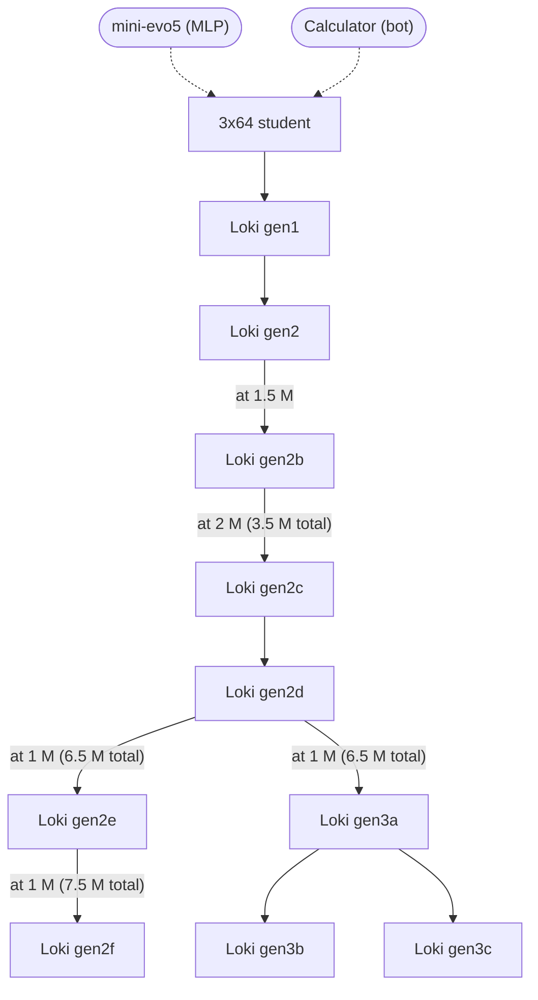
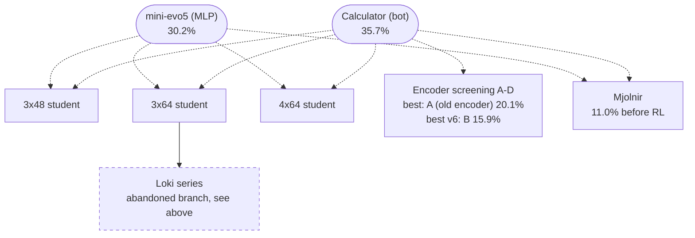

# Abandoned models

## Abandoned branch: Loki

Loki was an experiment in handing the whole training to an AI: all decisions about the next runs, their settings and
the points to continue from were made without supervision by the language model Claude Opus. The branch was abandoned: its best model, Loki gen3a, was only about 2 points above Loki gen2d
(see the [journal](journal/01-from-rule-bots-to-v7.md#7-transformers-the-loki-series)), and the lessons from it went into
the encoder and training work that led to njord. It is kept here as a record.

In this series a checkpoint is given by its own steps, with the total since the start of Loki gen2 in parentheses
(see "M steps" in the [glossary](glossary.md#how-we-train)); for example, Loki gen2d at 1 M (6.5 M total). The results
of each Loki are in the [glossary](glossary.md#transformers); they come from the old protocol (330 games), not the
main one.

Several Loki runs also used "Calculator" as a trade teacher during RL, and Loki gen2f played against Loki gen2c and
Loki gen2d as rival models. Those links are left out of the diagram for clarity.

## Abandoned learning tree of transformers from mini-evo5

The first njord attempt also started from scratch and stopped in the rules phase; it did not descend from this tree.
