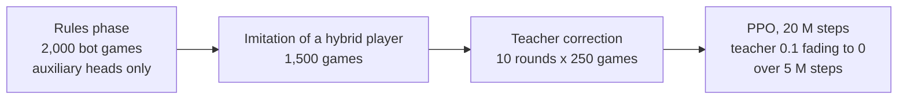

# Entry 1: From rule-based bots to encoder v7

*Covers the beginning of the project, from the first version of the game to encoder v7. All numbers come from our result
files, bot documentation and the project history. Where a number could not be recovered (several early model
folders were deleted), we say so instead of guessing. Terms such as "encoder", "trade window" or "teacher
correction" are explained in the [glossary](../glossary.md).*

If you read only three sections, read [In short](#in-short) below, [the absurd offers](#the-absurd-offers) (a model
that found a hole in the system) and [which part of the game loses?](#which-part-of-the-game-loses) together with
[Loki gen3](#loki-gen3-training-one-area) (why trading is hard for our models).

## In short

- **What we build:** a Monopoly-style game with nearly full rules, including open-ended trading, and small neural
  networks (multilayer perceptrons, MLPs, and transformers) that learn to play it against strong rule-based bots.
- **How we measure:** in our main protocol (1,320 games) a model plays against three copies of one bot, 11 bots x 30
  shared seeds x 4 seats; with four equal players chance level is 25% ([details](#1-the-question-and-how-we-measure)).
- **Where we stand:** our best model, mini-evo5, wins 30.2%; our best bot, "Calculator", wins 35.7%, probably but
  not certainly a real gap ([how mini-evo5 compares](#the-evo-family); all models named in this entry are listed in
  the [glossary](../glossary.md#models)).
- **The hardest area is trading:** offers composed by one of our models were accepted 0.6-1.8% of the time, against
  65% for its bot teacher's offers ([Loki gen3](#loki-gen3-training-one-area)); a diagnostic on one model, taking
  over one area at a time, points the same way but is not statistically significant
  ([which part of the game loses?](#which-part-of-the-game-loses)).
- **The most interesting discovery:** a small model found that it could flood other players with offers for nothing,
  and our other models handed it about $2.4 million of in-game money over about 1,700 games
  ([the absurd offers](#the-absurd-offers)).
- **What we train now:** njord-gen0, a 6-layer transformer on encoder v7 that imitates a hybrid of mini-evo5 and
  "Calculator" before reinforcement learning (RL) ([current experiment](#10-current-experiment-njord-gen0)).

## Contents

1. [The question and how we measure](#1-the-question-and-how-we-measure)
2. [The start: the game, the server and the first tools](#2-the-start-the-game-the-server-and-the-first-tools)
3. [The rule-based bots](#3-the-rule-based-bots)
4. [Rules evolution: toward full trading rights](#4-rules-evolution-toward-full-trading-rights)
5. [The RL toolkit: what the model sees and what it can do](#5-the-rl-toolkit-what-the-model-sees-and-what-it-can-do)
6. [Small MLPs and the "evo" family](#6-small-mlps-and-the-evo-family), including
   [the absurd offers](#the-absurd-offers)
7. [Transformers: the Loki series](#7-transformers-the-loki-series)
8. [Encoder v6 and the screening run](#8-encoder-v6-and-the-screening-run)
9. [Encoder v7](#9-encoder-v7)
10. [Current experiment: njord-gen0](#10-current-experiment-njord-gen0)
11. [Curiosities and failures](#11-curiosities-and-failures)
12. [What we learned so far](#12-what-we-learned-so-far)
13. [Limitations](#13-limitations)
14. [Open questions](#14-open-questions)

## 1. The question and how we measure

Rentcraft is a Monopoly-style board game built as a research testbed (see the [rules](../rules.md) for how Rentcraft
differs from Monopoly). The research question: **can a small neural network learn to play better than
well-written rule-based bots, including the hardest part of the game, trading with other players?**

We are learning RL on this project. A standing rule from the start: Claude (the AI
assistant that wrote most of the code) builds the tooling, and we choose the training settings and launch the
trainings ourselves, with one exception: in the Loki sprint we let Claude train models within a fixed time budget
([the Loki sprint](#the-loki-sprint)). Several decisions below were made in that split: a tool was built, then we decided how to use
it.

We mainly use four kinds of measurements, and the difference between them matters throughout this entry:

| Measurement | Setup | How much to trust it |
|---|---|---|
| **Main protocol (1,320 games)** | Model plus three copies of one bot, 11 bots x 30 seeds x 4 seats = 1,320 games per model, that is 330 deals each played once from every seat; every model plays the same seeds (see below) | Headline numbers. About +/-2.5 points (95% CI) on a mean near 30% if all games are independent, about +/-5 if only the 330 deals are (see below) |
| **Old protocol (330 games)** (Loki series) | 12 bots (the same 11 plus "Random") x 30 games, 330 games in the mean over 11 bots. Each bot's 30 games use 30 different seeds, the same for every model, and the model's seat rotates from game to game (8, 8, 7 and 7 games in seats 0 to 3), so each seed is played from one seat only | Repeatable, but smaller: about +/-4.7-4.9 points (95% CI) on the mean and about +/-16 points on a single bot |
| **Training evaluation** | 20 to 100 games per bot depending on the run (100 in the first small-32x32 runs, 50 in the simple runs, 20-40 in the evo series and the Loki students, 30 in the later Loki runs and the screening), new random seeds at every evaluation | Noisy; differences of 5 points are often just luck. It misled us many times |
| **Mixed bot tables** | 4 bots drawn from a pool, 500-1,000 games | Used to compare bots with each other |

A few results come from other measurements, each described where it is used: a fixed 300-game test of small-32x32
and its successors ([longer training](#longer-training-small-32x32)), tournaments between models and bots, including
successive-halving tournaments ([how mini-evo5 compares](#the-evo-family)), and a paired test of one area of play
([which part of the game loses?](#which-part-of-the-game-loses)).

**What a shared seed fixes.** A game has one random generator, seeded from the game's seed: it shuffles both card
decks at the start and produces every dice roll, in order. The bots' own random choices are seeded from the same
seed and their seat, and the model plays greedily (always its most likely move). So two models given the same seed
start with the same card order and the same stream of dice, and as long as they make the same decisions the game is
identical. Once a decision changes the flow of the game (for example who goes bankrupt and when, whether a utility
card's rent roll is needed, or when a jail release card leaves the deck and returns to the bottom), later rolls and
cards fall to different turns or players. Shared seeds therefore remove the luck of the starting draw and make each
result repeatable to the decimal, but they do not make the rest of the game equally lucky for every model.

**Wins and places.** A game ends when one player is left or, in simulations and training, after 200 rounds; then the
richest player by net worth wins ([the rules](../rules.md#simplifications)). In bot-only test games about 1-2% of
games reached the limit. Places run from 1 (the winner) to 4: players still in the game are ranked by net worth,
then bankrupt players in reverse order of going out. **Mean place** is the average of these places, 2.5 for four
equal players.

The 11 bots of the main protocol are "Investor", "Collector", "Miser", "Cautious", "Master", "Calculator",
"GPT-Style", "Tactician", "Absurd GPT-Style", "Absurd Calculator" and "Hustler" (all described in [bots.md](../bots.md)).
At every table the model sits with three copies of one of them, and each seed is played once from every seat.

With four equal players, chance level is 25%: each player would win a quarter of the games. "Mean over 11 bots"
always excludes the "Random" bot, which is reported separately as a sanity check (a sensible player should beat three
"Random" bots almost every time). For a bot measured in this protocol (such as "Calculator"'s 35.7%), the mean
includes its games against three copies of itself, where it wins 25% in expectation by definition, and against bots
that play almost like it ("Absurd Calculator" and "Hustler" for "Calculator"), so part of a bot's mean sits near
chance by construction.

Throughout this entry, "+/-X" next to a result is a 95% confidence interval (CI) unless we say that it is a standard
error (SE). **How independent the games are.** The main protocol consists of 330 deals (11 bots x 30 seeds), and each
deal is played from all 4 seats with the same seed, so the four games of a deal are not independent. The number of
effectively independent samples lies somewhere between 330 and 1,320. Our intervals for the main protocol treat all
1,320 games as independent, so they are the optimistic case:

| Main protocol, 95% CI | 1,320 independent games (optimistic) | 330 independent deals (conservative) |
|---|---|---|
| A mean near 30-36% | about +/-2.5-2.6 points | about +/-5 points |
| A mean near 11-16% | about +/-1.7-2.0 points | about +/-3.4-4.0 points |
| The difference between two means near 30-36% | about +/-3.6 points | about +/-7 points |
| A single bot (120 games, 30 deals) | about +/-8 points | about +/-16 points |

Several bots also form families of similar players ([limitations](#13-limitations)), which a mean over 11 bots does
not account for. **Selection and test seeds.** The main-protocol seeds are a fixed block that training evaluations,
tournaments and bot tuning do not use (they draw other seeds), so mini-evo5 was not selected, and the bots were not
tuned, on them. We did, however, compare encoder variants and other experiments in the main protocol itself, and we
have not kept a separate, untouched set of test seeds, so the separation between selection and test is not strict.

The two protocols give slightly different numbers for the same player: "Calculator" wins 35.7% and mini-evo5 30.2%
in the main protocol, and 35.8% and 30.3% in the old protocol. Where we quote old-protocol numbers, we say so.

## 2. The start: the game, the server and the first tools

The design document fixed the goals and, just as importantly, the **anti-goals** (outcomes that count as failure even
if everything "works"):

- An engine that deviates from the official rules in details (auctions, even building, the house limit, jail,
  bankruptcy). Undocumented deviations from the rules make the research worthless.
- An engine too slow for RL, which needs millions of games.
- Non-deterministic games. The same seed and the same decisions must give the same game, otherwise there are no
  replays and no repeatable experiments.
- A training interface that assumes an expert.
- Using Hasbro's trademarks or original names. The board has its own street names, the cards have their own texts
  with the original effects, and the currency is "$".

The engine is pure Python with no I/O: a state machine that at every moment knows which player must decide and
returns the list of legal actions. All randomness comes from a seeded generator stored in the game state. It was
built together with a test scenario for every rule. Right after that, the official rule for selling a hotel during a house shortage was implemented exactly (the whole color group comes down evenly), instead of the
simpler "remove one hotel".

The rest of the first stage, in order:

- **Server** with REST, WebSocket and an **MCP server** (Model Context Protocol), so that an AI agent can join a table from one sentence
  ("connect to the Rentcraft MCP, sit at table X and win"). The agent sees a readable state (street names, who holds
  each property, rents) and can attach a free-text justification to every move, saved in the replay.
- **Browser game** with a 3D table: a cardboard board on a wooden table, property cards lying in front of each
  player, wild-animal pawns, 3D dice, camera presets, and a lobby where each seat can be a human, a bot, an MCP/API
  agent or an RL model.
- **Trades.** A measurement showed that without trades about two thirds of games never end (nobody completes a
  color group), so trades came before RL: any combination of properties, cash and jail release cards in
  both directions, with **accept, reject or counter-offer**, at most 4 offers per negotiation and 3 negotiations per
  turn.
- **RL module**: a PettingZoo/Gymnasium environment, PPO (Proximal Policy Optimization) with action masking, experiments as YAML files that are
  also editable in a browser wizard with "?" explanations for a beginner, imitation of bots as a starting point.
- **Training panel, replays and rankings**: replays with a timeline and an "inside the player's head" panel (for a
  model: probabilities of its legal moves and its value estimate; for a bot: the rule that fired; for an LLM agent:
  its justification), Elo ratings (later replaced by a Bradley-Terry fit on the Elo scale for stability), and
  tournaments.
- **The first bots**: "Random", then four personalities ("Investor", "Collector", "Miser", "Cautious"), then
  "Master" and "Calculator".

## 3. The rule-based bots

Our bots are rule-based AI: each plays by a fixed set of hand-written rules and writes a short justification for
every decision (visible in replays). They serve three purposes: **opponents** during training, **teachers** to
imitate, and **yardsticks**. Each bot has its own page with its rules, origin and measured strength; the overview
with all of them is in [bots.md](../bots.md).

### The bots in brief

- ["Random"](../bots.md#random) picks a random legal move and never proposes trades. It is the floor every sensible
  player should beat, and some of our models did not.
- ["Investor"](../bots.md#investor), ["Collector"](../bots.md#collector), ["Miser"](../bots.md#miser) and
  ["Cautious"](../bots.md#cautious) are the four personalities planned in the design document: an aggressive
  spender, a hunter of orange and red, and two hoarders of cash. In the first 600-game tournament (four-player tables
  drawn from six bots: these four, "Master" and "Random"; "Calculator" did not exist yet) spending aggressively paid
  off and hoarding cash did not ("Investor" 41.3%, "Miser" 13.7%).
- ["Master"](../bots.md#master) follows the published advice of world champions. Testing the advice one rule at a time
  (three one-rule variants were compared, which raises the chance of a lucky result) gave the largest change for dropping one rule, avoid dark blue (+4.1 points), the
  only change near the edge of noise (about +/-4.3 points for a difference at 800 games); refusing hotels may cost a
  little too, but that result is within noise. This makes it a useful test of whether a model that imitates it can drop its weak
  rules.
- ["Calculator"](../bots.md#calculator) computes every decision from board probabilities (a Markov chain). It has
  remained our strongest bot and main reference: in the main protocol it wins **35.7%**.
- ["GPT-Style"](../bots.md#gpt-style) has the most unusual origin. After a few games against the GPT-6.1-Sol language
  model, connected through our MCP server, we asked GPT-6.1-Sol to describe in text how it plays; Claude Opus
  implemented its 12-point description as a rule-based bot. It became the strongest bot of its time and the first
  bot our models imitated.
- ["Tactician"](../bots.md#tactician) is "GPT-Style" with two fixes in trade evaluation, exposed by tournaments with
  the absurd bots.
- ["Simulator" and "Fast Simulator"](../bots.md#simulator-and-fast-simulator) play out short imaginary continuations before important
  decisions instead of guessing with rules. They are too slow to be training opponents.
- ["Absurd GPT-Style", "Absurd Calculator", "Absurd Investor"](../bots.md#absurd-bots) and
  ["Hustler"](../bots.md#hustler) add deliberately bad offers to the originals' play. They exist because one of our
  models discovered such offers on its own ([the absurd offers](#the-absurd-offers)).

### Tuning, and why we undid half of it

After the big rule changes described in the next section, bots behaved badly in live games: they sold rivals the
properties that completed their color groups for small premiums, ran auctions in $1 steps (149.6 raises per
auction, 96% of auctions with 20 or more raises, the longest 420), and were left with tens of dollars after building.
Three shared safeguards fixed this for all bots:

- **No feeding rivals**: a bot does not give away a property that completes a rival's group (or gives them two of
  three) unless the price compensates; the rival's gain may be at most 1.25x the bot's own (stricter 1.0 and looser
  1.5 were both worse for all 8 bots).
- **Big auction steps**: raise by the largest step that fits the limit and is at most 25% of the current price.
- **A cash buffer after building** proportional to the rent risk ahead.

| Per game or per auction | Before | After |
|---|---|---|
| Raises per auction | 149.6 | 8.5 |
| Raises of $1 | 99% | 12% |
| Auctions with 20+ raises | 96.0% | 3.9% |
| Rival-feeding trades without compensation | 5.40 | 0 |
| Games per second (1 process) | 3.96 | 5.37 |

Then each bot's numbers were tuned by coordinate search, 800 paired games per setting. The spread narrowed from
9.6-35.2% to 15.0-31.9%. But tuning for strength **flattened the characters**: "Miser" and "Cautious" built like
everyone else, "Collector" stopped overpaying for its colors, "Master" built hotels and bought dark blue. So we
restored the character-defining rules and allowed tuning **only within a character**, plus a new house blockade for "Master" (when 10 or fewer houses remain in the bank and a rival can build, it buys houses
beyond its normal need and builds no hotels while a rival needs houses).

Two shared variability parameters were added at the same time, because deterministic bots can be exploited by
memorizing their exact responses: **trade variability** (sometimes a different trade candidate, cash amounts
+/-variability x 20%, a fuzzier acceptance threshold; 0.1 for "Calculator", 0.3 for "Investor" and "Collector") and
**random moves** (an epsilon of random legal actions, 0 by default). And a **debtor rescue**: a live game showed
"Calculator" going bankrupt over a $13 shortfall because its anti-feeding rule made it ask $720, then $1,090 for a
property, while bankruptcy handed everything to the creditor anyway. Now a bot facing certain bankruptcy accepts any
offer that covers the debt and asks only for the missing amount plus $10.

Final mixed-table results (1,000 games, 4 bots drawn at random from 8):

| Bot | Wins after tuning | Wins with characters restored | Mean place |
|---|---|---|---|
| "Calculator" | 31.9% | 34.4% | 2.34 |
| "Tactician" | 28.8% | 32.2% | 2.26 |
| "GPT-Style" | 30.6% | 30.6% | 2.32 |
| "Investor" | 26.1% | 26.3% | 2.57 |
| "Master" | 25.6% | 24.4% | 2.52 |
| "Collector" | 20.3% | 21.5% | 2.61 |
| "Cautious" | 20.9% | 17.1% | 2.66 |
| "Miser" | 15.0% | 12.2% | 2.75 |

Restoring the characters cost "Miser" about 3 points, "Cautious" about 4 and "Master" (no hotels, avoiding dark
blue) about 1 point in these tables. All three changes are within noise: each bot played about 500 of the 1,000
games, so the difference between its two values carries about +/-4.4-5 points (95% CI). ("Master"'s pool here differs
from the one-rule tests in [bots.md](../bots.md#master).) Our best model at the time, mini-evo5, won 28.0% before and 34.0% after against 3 bots drawn at
random from 8 (200 games each, about +/-6 points on each value). That difference is within noise; at most it hints that restoring weaker
characters made the pool slightly easier.

## 4. Rules evolution: toward full trading rights

The first version of trades allowed proposals only by the player on turn, before or after rolling. Later we found
that trading was blocked while deciding whether to buy a property and while paying a debt, a simplification nobody
had asked for. We consider trading the core of the game and accepted large compute and speed costs for full trading
rights. The standing rule since then: default to the official rule; any unavoidable restriction must be flagged before it is built.

We number the rules versions: version 1 is everything before trade windows, version 2 added trade windows and trade
requests, and versions 3 to 5 are the later changes listed below. The changes, in order:

- **Trades at every decision point**, including the purchase decision and debt collection (a debtor may propose even
  outside their own turn, with a separate negotiation limit per debt). The game returns to the same decision after
  every negotiation.
- **Trade windows**: at fixed moments (before a payment, after a property is acquired, after a negotiation, at the
  end of a turn) every other player in turn gets one slot to manage assets and propose one trade or pass. Windows do
  not nest, and the game returns exactly where it was. Humans and MCP agents can also request a trade at any time;
  the request is served at the next safe moment.
- **Rules version 3**: a starting roll (until then seat 0 always started, so it started 100% of games; after the change seats
  0 to 3 started 26/25/30/19% of 500 simulated bot games, each share with about +/-4 points of noise), a choice when a mortgaged property changes hands (repay now or pay 10% interest),
  **bids not limited by the bidder's cash** (a technical cap of $10,000 per bid; overbidding becomes a debt to the
  bank and possibly bankruptcy), several
  creditors in one bankruptcy, and full asset management when answering an offer.
- **Rules version 4**: full rights (trading, mortgaging) when deciding about a taken-over mortgaged property.
- **Rules version 5**: resignation settles creditors first through a bank liquidation, and an offer may ask for cash the
  recipient can raise from the bank.

Rankings and replays are kept separately per rules version, since results under different rules are not comparable.

What the windows changed (500 bot games, 4 bots drawn at random from 8, 200-round limit):

| | Windows off | At payments only | Full |
|---|---|---|---|
| Rounds per game | 66.2 | 57.6 | 55.3 |
| Decisions per game | 1,188 | 1,425 | 1,965 |
| Trades per game | 12.0 | 13.9 | 13.7 |
| Trades in own turn | 4.43 | 1.67 | 0.32 |
| Trades in the window before a payment | - | 5.53 | 4.39 |

Trading moved from players' own turns into the windows, mostly into the window before a payment (buying the
missing street from the player who is about to pay). The table counts the decisions of all players in bot games
(1,965 against 1,188, about 1.65x more with full windows). For a model the effect is larger: in a separate
measurement (50 games per setting of a 32x32 model from the mini-evo5 run against "Calculator", "GPT-Style" and "Investor") the model made 1,036
decisions per game with full windows against 434 without, about 2.4x more. Window decisions are cheap (usually
"pass"), so a game takes only about 1.6x longer.

Rules version 3 also reshuffled the bot ranking: in 500-game mixed tables "GPT-Style" moved to the top (36%, "Calculator"
33%). The bots' numbers had been chosen under the old rules, which is why they were retuned right after
([tuning](#tuning-and-why-we-undid-half-of-it)).

## 5. The RL toolkit: what the model sees and what it can do

### Encoders (observations)

The encoder turns the game state into numbers. It has gone through eight generations so far (counting the freely
combined blocks as one):

| Encoder | What it adds | Size |
|---|---|---|
| standard-v1 | Board, players (always "me" first), the current decision | 516 |
| standard-v2 | Contents of ready-made trade candidates | 561 |
| v3-full-info | Everything visible at the table: whose turn, who bids and leads, rounds left, last roll | 583 |
| v4-full-with-small-memory | v3 plus simple game memory: offers made, accepted and rejected per rival, overbidding, rent paid, 6 recent events | 725 |
| v5-lite / v5-full | v3 (lite) or v4 (full) plus rents, prices, expected rent per roll and roll risk: everything "Calculator" computes from | 725 / 867 |
| Blocks | Free combination of blocks (trade context, liquidity, offer history, cards, changes since my last turn, trade window...) | varies |
| v6 | Facts and rules only, an event log and per-pair offer history | up to 2,275 |
| v7 | A closed set of blocks, a log of real events only | 3,374 by default (64-entry log, 4 offers per direction); 3,734 in njord-gen0 (8 offers per direction) |

v4 and v5-lite have the same size by coincidence: the memory block and the rent block each add 142 numbers to v3.

The early encoders (v1-v5 and the blocks) give the model many **ready-made judgments** computed by bot heuristics:
the value of a trade, whether it completes a set, expected rent, liquidity, card odds. That makes learning faster,
but the model mostly learns to reproduce the bots. v6 and v7 deliberately remove them
([encoder v6](#8-encoder-v6-and-the-screening-run)).

The first two encoders share their names with the two action spaces below (standard-v1 and standard-v2), but they are
separate settings: the encoder decides what the model sees, the action space what it can do. Below, "standard-v1" and
"standard-v2" mean the action spaces unless we say "encoder".

### Action spaces: picking candidates vs. composing offers

- **standard-v1** (178 actions): rolling, buying, bidding, building, mortgaging and so on for every square, plus
  trades as a **choice among a few candidates** produced by the same generator the bots use. This is the "hybrid"
  approach from the literature: the model decides, simple code proposes. Its weakness: the model can never propose
  a trade the generator did not think of, so it cannot out-trade the bots.
- **standard-v2** (221 actions): the model **composes an offer itself, step by step**: start from a
  generator candidate, an empty offer to a chosen rival, or (when answering) the received offer; then add or remove
  any property, add or request cash in steps of $25/$100/$500, add a jail card; then send or cancel. Up to 16 edit
  steps and 3 drafts per decision. Imitation decomposes bot offers into the same steps. From v6 on there are no
  generator candidates at all, so every offer starts empty or from a received offer.

One rule in the action mask goes beyond the game rules: **a model cannot undo a change to a property within the
same turn** (no mortgaging and redeeming the same street, no building and selling the same house). The rules allow
it, but it only ever costs money, and without the mask models discovered it as a stalling loop: small-32x32 did it in
one game in four, losing about $900 per game, after only 2 M steps of RL.

### Training methods added along the way

| Method | Why |
|---|---|
| Imitation of a bot (behavior cloning) | A random network does not even know buying streets is good |
| Discount per game turn instead of per decision | With per-decision discounting a losing model profits from making dozens of useless moves to postpone the loss |
| Reward shaping (net worth, sets, expected-rent lead, penalties and bonuses for trades) | The win/loss signal arrives after hundreds of decisions |
| KL penalty to the starting model | PPO kept destroying what imitation taught |
| Live trade teacher in PPO | A bot labels every trade decision the model faces, a DAgger-style signal |
| Teacher correction before RL ("teach", DAgger) | The model plays; teachers label its decisions per area; data accumulates over rounds |
| Transformer next to MLP | Every square, player and history entry as its own token |
| Entropy bonus per decision type | Some decision types froze early (e.g. counter-offers) |
| Checkpoint weight averaging | Smooths out noise between checkpoints |
| Successive-halving tournaments | Pick the best of many checkpoints without playing all of them to the end |
| Area delegation and paired reward | Isolate the signal of one area (e.g. trades) from the rest of the game |
| Start from snapshots of bot trade moments | Composing a good offer by random exploration is too rare |
| Rules phase and auxiliary heads | Teach the network to read the state before teaching it to act |
| Held-out games, per-head criterion, freezing a memorizing head | A large network memorized games |

Several reward terms came from watching models misbehave: a penalty for voluntary mortgages (small-evo
mortgaged 9 times per game while holding about $900, then redeemed 69% of them within 4 turns, paying 10% interest
each time), a penalty for helping a rival complete a group in a trade (mini-evo3 sold rivals the dark blues that
completed their set for $670-840), and a small penalty for drafts canceled without sending (mini-evo5 opened and
immediately canceled 376 empty drafts per game).

## 6. Small MLPs and the "evo" family

Which model was trained from which is shown in the [model lineage](../lineage.md) diagram, kept on a separate
page because it grows with every new model.

The very first runs (a few short PPO tests on standard-v1, 400 k steps each) and two early configurations (a 512-256
MLP on v5-full imitating "GPT-Style", and its continuation) left no surviving results.

### PPO drifts without an anchor

**simple-small-32x32** (MLP 32x32, imitation of "GPT-Style" on 5,000 games, then 5 M steps of PPO). Mean over the
training evaluations: 19.4% after imitation, 25.4% after 0.5 M steps, **13.4% after 5 M**.

**simple-kl-32x32** and **simple-kl2-32x32** added a KL penalty to the imitated model (0.1, later 0.05). simple-kl:
16.6% -> 32.0% at 1 M -> 17.7% at 2 M. simple-kl2: 31.4% -> 35.7% at 3 M -> 33.4% at 4 M. simple-kl2 continued from simple-kl at 1 M, so its starting
31.4% is the same checkpoint as simple-kl's 32.0% at 1 M, measured again on new seeds (50 games per bot), not a
different starting point.

This was the first appearance of a pattern that ran through the whole project, so we describe it once here. **Without
an anchor** (a KL penalty to the starting model, or a teacher that labels the model's decisions), the PPO reward
signal is too weak and noisy to hold what imitation taught: the model drifts away from it, and the longer it trains,
the weaker it gets. **With an anchor** it stays stable, but it plateaus close to where it started, and the gain from
RL itself is small. This is not our discovery: it matches what is known about fine-tuning an imitation-learned
policy with RL, and keeping such a policy close to the imitated one with a KL penalty is an established remedy (see
[closest related methods](../related-work.md#closest-related-methods-and-games), for example AlphaStar). Later we saw the same in the Loki series (Loki gen2b fell apart as its teacher faded, Loki gen2c and Loki gen2d
with permanent anchors plateaued at 21-25%; see [the Loki sprint](#the-loki-sprint)) and, more weakly, in the v6
screening ([screening](#screening-phase-a)). The best results came from
methods that give a dense signal at every decision: imitation and teacher correction. (Checkpoint weight averaging,
which produced our best model, mini-evo5, is not such a method, and in the Loki series it gave no gain.)

### Longer training: small-32x32

**small-32x32** (MLP 32x32 with memory, rents, sets and debt blocks, imitation of "GPT-Style" on 3,000 games, stopped at
20 M of a planned 200 M steps). On a fixed 300-game test against "GPT-Style", "Calculator" and "Investor": 11.0% after
imitation, 22.0% at 2 M, 25.3% at 6 M, 27.0% at 18 M, 26.3% at 20 M (mean place 2.61). Its training evaluation over
the same period read 18.4% -> 37.6% -> 40.6%, but that is a different protocol and not directly comparable: it
played 100 games against each of the seven bots of the time, including the weak "Miser" and "Cautious", on new seeds
every time. Against the three bots of the fixed test alone, the
same training evaluations read 17.7% -> 29.3% -> 31.0%.

### Composing trades is hard

**small-trades-32x32** continued small-32x32 at 6 M on the new step-by-step action space and dropped to **9-13%** on
the same 300-game test against bots: composing offers itself cost it its strength. Against other models, though, it
found something nobody had designed for ([the absurd offers](#the-absurd-offers), below).

Two attempts to teach trades followed: **small-32x32-trade-teacher**, with a live trade teacher ("Tactician") inside
PPO (5.2% -> 14.2% in training evaluation over 1 M steps), and **small-32x32-trade-dagger**, with four DAgger rounds
of 500 games from "Tactician" before RL (the trade error, the mean cross-entropy of the teacher's choices on
held-out decisions, fell from 1.25 to 0.06 and rose again to 0.49 by round 4;
evaluation 14.7% -> 10.7%). Lower error did not turn into wins.

**The fit test.** Is a 32x32 network simply too small to imitate "Tactician"'s trades? An RL-trained 32x32 model with
a live trade teacher played 600 games, "Tactician" labeled each of its trade decisions (154,000 labels), and networks
of four sizes were trained supervised from scratch on these labels. The validation loss against the teacher
(cross-entropy of the teacher's choices on held-out games) was 0.293 for the RL-trained 32x32, but **0.196, 0.197,
0.194 and 0.195** for 32x32, 64x64, 128x128 and 256x256 networks, and the widened networks barely used their new
neurons. Two conclusions follow, and they should be kept apart:

- **The RL-trained model was held back by its training method, not by its size:** a supervised 32x32 network
  reached a much lower loss on the same labels.
- **The equal loss of the four sizes does not show that size never matters.** It may be a floor: the part of the
  teacher's choices that cannot be predicted from what the model sees, which no network size can remove. This test
  measures how far a network can get on these labels, not how well it plays.

The 0.06 reached in small-32x32-trade-dagger (above) is a different measurement and not comparable: it was taken
after the first DAgger round, on about 50,000 labels from 500 games played by the starting model, and the same loss
rose to 0.47 as soon as the data also contained the states the corrected model reached. The fit test uses another
model's games and another data set. (The same analysis found 16-22% dead ReLU neurons in 32x32 networks, which is
why GELU, SiLU and leaky ReLU became options.)

### The absurd offers

**A small model we built to play the game found a hole in the system and exploited it ruthlessly.** It was our first
really interesting discovery, and it showed us that as soon as a model can find a workaround that shortens the road
to victory, it immediately tries to exploit it.

When we designed the bots and the training, we did not think about offers for nothing at all. Then, once models could
compose their own offers step by step, one of the first of them, small-trades-32x32, **discovered this strategy on its
own through RL**: it learned to flood the other players with offers for nothing (cash for nothing, a property for
pennies, the jail card for nothing, a junk property for a fortune) and to exploit a weakness of the other models that
nobody had designed for. In training it played not only against bots but also against its own earlier versions
(weight 0.3 in the opponent mix) and against itself (0.2); those copies of the model accepted such offers, so RL
rewarded it for sending them.

The numbers show what it found. In a 3,000-game tournament, every four-player table was drawn at random from a pool
of seven: three bots ("GPT-Style", "Calculator" and "Investor") and four of our RL models (small-trades-32x32 itself,
small-32x32 at 6 M steps, and simple-kl2-32x32 both final and at 4 M steps). Each player sat at about 1,700 of the
tables, and small-trades-32x32 won **48.9%** of its 1,707 games ("GPT-Style" 28.9%, "Calculator" 28.4%, "Investor"
21.5%, the three other models 14.5-17.7%). The rule-based bots accepted no gifts: "GPT-Style" accepted 0 of 51,875
such offers and "Calculator" 0 of 49,012. "Investor" accepted 347 of 42,705: our count of offers for nothing was
broad enough to include a cheap but fair one, selling "Investor" the jail release card for $25 (it values the card
at $50), and that offer makes up most of the 347; we did not check the rest one by one
([details](../bots.md#investor)). Our other RL models did accept gifts: they **accepted 35-47% of these offers**.
simple-kl2-32x32 accepted 4,862 of 13,878 and gave away about $847,000 net; small-32x32 at 6 M steps accepted 5,004
of 10,741 and gave away about $692,000. That checkpoint, one of the main victims, is the very one small-trades-32x32
had started from: the model learned to exploit its own starting point. In total our RL models **handed it about $2.4
million** of in-game money over those roughly 1,700 games. These dollar sums are the net value that moved to
small-trades-32x32 in the accepted offers by our count; we cannot reconstruct exactly how that count weighed
properties and cards against cash, so treat them as approximate. At a table with bots only, the same model won just
9-13%. Our RL models had never seen such offers in training, so they had never learned to refuse them, and the
tournament and the Elo ranking were distorted by it.

Our response was to add bots whose job is to supply bad offers, so that models see them in training and learn to
refuse them: ["Absurd GPT-Style", "Absurd Calculator", "Absurd Investor"](../bots.md#absurd-bots), which play like the
originals but send one clearly unprofitable offer per turn, and ["Hustler"](../bots.md#hustler), which plays like
"Calculator" and tries up to twice per turn. They answer offers like the originals, so they cannot be exploited
themselves, and they are mixed into training opponents as a robustness test. Tournaments with them also exposed two
flaws in "GPT-Style"'s trade evaluation, which led to ["Tactician"](../bots.md#tactician).

### The "evo" family

The family started from small-32x32, continued for 1 M steps with step-by-step trades and blocks for offer history,
liquidity and offers (28.3% -> 39.0% -> 32.7% in training evaluation); that intermediate model was the starting point
of **small-evo**. A 32x32x32 student continued from an imitation model fell from 13.5% to 4.0% under RL and was
dropped.

| Model | Started from | Notes | Training evaluation |
|---|---|---|---|
| small-evo | small-32x32 + 1 M steps with trade blocks | 5 M steps | 19.7% -> 24.7% (2 M) -> 19.7% |
| mini-evo2 | small-evo | stopped at 37.9 M | 15.4-26.3%, no trend |
| mini-evo3 | mini-evo2 | 2 DAgger rounds of trades from "Calculator" (500 and 1,000 games), 5 M | 31.2% -> 37.1% -> 34.2% |
| mini-evo4 | mini-evo3 | 10 M | peak 44.2% at 5 M, 38.3% at 10 M |
| **mini-evo5** | mini-evo4 at 8 M | mini-evo4 also as a rival model, stopped at 12.1 M (27,904 games) | 39.4% -> 44.0% -> 38.1% |

The final mini-evo5 is **the average of the weights of 9 checkpoints between 10 M and 12 M steps** of its own run
(step counts restart with every run; mini-evo5 started from mini-evo4 at 8 M). All evo models are MLP 32x32 with
step-by-step trades but with generator candidates still in the encoder (so they can start an offer from a
candidate).

**Under which rules mini-evo5 trained.** The whole evo family, mini-evo5 included, trained under rules version 1,
before trade windows existed ([rules evolution](#4-rules-evolution-toward-full-trading-rights)). That is why
mini-evo5 made about 430 decisions per game in training (12.1 M steps over 27,904 games), close to the 434 per game
we later measured for a model from its run without windows, and far from the 1,036 with full windows. All its
results below, including the 30.2% of the main protocol, were measured with full trade windows, a setting it never
trained in.

How mini-evo5 compares, across protocols:

- 20,000-game tournament (pool of 10): **28.1%** (mean place 2.45), ahead of its own checkpoints (27.1-27.6%),
  "Tactician" 24.2%, "GPT-Style" 24.2%, "Calculator" 23.0%, "Absurd GPT-Style" 22.4%, "Absurd Calculator" 21.5%.
- Successive-halving tournament (6,000 games): the averaged model 36.8% and the checkpoint after 4 M of mini-evo5's
  own steps 34.5% (each over all its games) went through to round 2, which the 4 M checkpoint won; "Tactician" 23.4%,
  "Calculator" 23.3%.
- Main protocol (1,320 games): **30.2%** (95% interval 27.7-32.7% if all games are independent, about 25-35% if
  only the 330 deals are) against "Calculator"'s 35.7%. Per bot it ranges from 21.7% against three "GPT-Style" bots
  to 46.7% against three "Misers"; each single-bot value carries about +/-8 points, and the lowest and highest of 11
  noisy values are pushed apart by chance, so these extremes do not rank the opponents. The gap to "Calculator" is
  5.5 points. Treating all 1,320 games of each as independent, its 95% interval is about 1.9-9.1 points (+/-3.6, the
  square root of the sum of the two squared standard errors times 1.96), but that is the optimistic case
  ([how independent the games are](#1-the-question-and-how-we-measure)); with only the 330 deals independent it is
  about -1.7 to 12.7 points (+/-7). So "Calculator" is probably, but not certainly, the stronger player. Our result
  files keep wins per bot and seat but not per seed, so we could not compute a paired interval, which could be
  narrower.

It is available as an opponent in our game (not yet public). Its strange
weakness: against three "Random" bots it wins only **66.7%** instead of nearly 100%, and it loses only through
bankruptcy. The "Random" bots bid recklessly in auctions, and the model's own bidding was never anchored by a teacher.

### mini-evo5 against the Bonjour bots

A later measurement: we played mini-evo5 against our bots built on the tactics of the fixed-policy opponents of Bonjour et
al. (["Bonjour A", "Bonjour B" and "Bonjour C"](../bots.md#bonjour-a-b-c); the story of those bots is in
[entry 2](02-the-bonjour-bots.md)). The paper's evaluation puts one learning player at a table with FP-A, FP-B and
FP-C, so we did the same with mini-evo5 and, for comparison, with "Calculator" in the same seat: 250 seeds x 4 seat
rotations = 1,000 games per table, full trade windows, 200-round limit.

| Player | Table with mini-evo5 | Table with "Calculator" |
|---|---|---|
| The tested player | 15.4% (13.3-17.8), mean place 2.77 | 13.9% (11.9-16.2), mean place 2.72 |
| "Bonjour A" | 15.3% (13.2-17.7) | 9.6% (7.9-11.6) |
| "Bonjour B" | 27.9% (25.2-30.8) | 23.7% (21.2-26.4) |
| "Bonjour C" | 41.4% (38.4-44.5) | 52.8% (49.7-55.9) |

Both mini-evo5 and "Calculator" win well below 25%, and the difference between them (1.5 points) is within noise.
"Bonjour C" wins more at the table with "Calculator" than at the table with mini-evo5 (52.8% against 41.4%), which fits
the [mechanism](02-the-bonjour-bots.md#the-mechanism) by which the Bonjour bots beat our bots, but we have not checked
the trades behind it.

In the format of the main protocol (the tested player plus three copies of one variant, 30 shared seeds x 4 seats = 120
games per variant):

| Tested player | 3 x "Bonjour A" | 3 x "Bonjour B" | 3 x "Bonjour C" | All 360 games |
|---|---|---|---|---|
| mini-evo5 | 22.5% (16.0-30.8) | 16.7% (11.1-24.3) | 15.8% (10.4-23.4) | 18.3% (14.7-22.7) |
| "Calculator" | 25.8% (18.8-34.3) | 25.8% (18.8-34.3) | 18.3% (12.4-26.2) | 23.3% (19.3-28.0) |

Single-variant values rest on 120 games (about +/-8 points); the 5-point gap between the totals is within noise. All
intervals are Wilson intervals that treat games as independent, the optimistic case.

In the paper, FP-A, FP-B and FP-C won 7.69%, 8.79% and 13.57% of games against standard PPO (69.95%), and 2.07%, 2.88%
and 3.40% against hybrid PPO (91.65%). **Neither mini-evo5 nor "Calculator" reaches even the 25% chance level at this
table.** The numbers are not directly comparable, for several reasons:

- the rules differ: our game has full trade windows, auctions in fixed steps, counter-offers and the other differences
  listed in [the GNOME simulator](../related-work.md#the-gnome-simulator);
- our "Bonjour B" and "Bonjour C" are built from the paper's description, not from code, and they may be stronger than
  FP-B and FP-C as the authors ran them;
- mini-evo5 trained under rules version 1, without trade windows (see above), and it never met the Bonjour bots in
  training, while the paper's PPO players trained against FP-A, FP-B and FP-C;
- our players sell lone properties for 1.125x the price, which the Bonjour bots exploit.

## 7. Transformers: the Loki series

### Distillation into a transformer

MLP weights cannot be moved into a transformer, so transformers start by learning from teachers. Three "student"
transformers were trained from scratch with teacher correction only (two of them
without generator candidates, so they had to compose every offer themselves): buying and asset management taught by mini-evo5, auctions and trades by "Calculator".

| Student | Parameters | DAgger | Teacher error | Training evaluation |
|---|---|---|---|---|
| 3x48 (with candidates) | 85,950 | 10 rounds x 250 games | 2.18 -> 0.14 | 27.3% |
| 3x64 (no candidates) | 136,478 | 6 rounds | 2.44 -> 0.32 | 14.8% |
| 4x64 (no candidates) | 169,950 | stopped in round 4 | - | - |

These are training evaluations (40 games against each of the 11 bots, on new seeds), not the main protocol in
which mini-evo5 wins 30.2%, so the students cannot be compared with mini-evo5 directly. Within the same kind of
evaluation, the 3x48 student, which could still start offers from generator candidates, scored almost twice as much
as the 3x64 student without candidates (27.3% vs 14.8%). The 3x64 student became the start of the **Loki** series.

### The Loki sprint

We gave Claude a task with a fixed time budget: train the best possible model in any way, write down
discoveries and the reason for every decision, and test each version from several angles. Steps in the Loki series
are given as each run's own steps (its step count restarts at 0), with the total since the start of Loki gen2 in
parentheses: Loki gen2b at 2 M (3.5 M total) is 2 M steps into gen2b, which started from Loki gen2 at 1.5 M. The log,
in short:

- **Loki gen1** (1 M RL steps from the 3x64 student): 14.8% -> **8.6%** in training evaluations. Own offers died out (2-3 per 1,000 decisions)
  because a penalty for canceled drafts existed but no bonus for sending.
- **Loki gen2** (trade teacher "Calculator" fading from 0.3 to 0, a bonus for own offers): 23.2% at 1 M (1 M total)
  in a partial training evaluation on 7 bots (the old protocol below put the same checkpoint at 13.9%); measured on
  offers: it answered offers well, opened about 135 drafts per game and **sent zero**; all improvement
  came from the rest of the game. It ended at about 1.6 M of a planned 5 M steps; its last saved checkpoint, at
  1.5 M, is the one measured below and the start of Loki gen2b.
- **Loki gen2b** (from Loki gen2 at 1.5 M; stronger, deterministic teacher fading to 0 over 2.5 M steps). Once the
  training evaluations were replaced by the [old protocol (330 games)](#1-the-question-and-how-we-measure) (about
  +/-4.7-4.9 points on a mean, about +/-16 on a single bot), the picture was clear (table below).

| Checkpoint, own steps (total) | Mean over 11 bots | vs "Random" |
|---|---|---|
| Loki gen2 1.0 M (1.0 M) | 13.9% | 80% |
| Loki gen2 1.5 M (1.5 M) | 10.0% | 90% |
| Loki gen2b 1.0 M (2.5 M) | 10.6% | 100% |
| Loki gen2b 2.0 M (3.5 M) | **16.7%** | 83% |
| Loki gen2b 3.0 M (4.5 M) | 12.1% | **0%** |
| Loki gen2b final 3.5 M (5.0 M) | 4.8% | 93% |

**Loki gen2b fell apart as soon as the teacher faded**, the [drift without an anchor](#ppo-drifts-without-an-anchor)
again. The 0% against "Random" bots: in 3 of 4 inspected games the model went bankrupt in rounds 5-18 by outbidding
the reckless "Random" bots in auctions. Auctions had no anchor at all, since the teacher covered only trades. The
sprint continued:

- **Loki gen2c** (from Loki gen2b at 2 M (3.5 M total); anchors that never fade: teacher 0.3 and KL 0.05 to the start point, half the learning
  rate, bonus only for offers the model initiates): **23.9%** at its end, 2 M (5.5 M total), +7 points, with no collapse along the way. First own
  offers actually sent (1.25 per game).
- **Loki gen2d** (same recipe from the end of Loki gen2c): best checkpoint **24.8%** at 1 M (6.5 M total) ("Calculator"
  30%), but overall a plateau at 21-25%, the other half of the [anchor problem](#ppo-drifts-without-an-anchor).
- **Loki gen2e** (from Loki gen2d at 1 M (6.5 M total); 3 DAgger rounds of auctions and trades, then 1.5 M RL): **100% against "Random"** in every checkpoint,
  so teaching auctions fixed the overbidding, but against the strongest bots it got weaker (19.4-23.9% mean).
- **Weight averaging** of Loki gen2d checkpoints: 22.4% and 21.2%, no gain.
- **Loki gen2f** (from Loki gen2e at 1 M (7.5 M total); "league": Loki gen2c and Loki gen2d as rival models): 24.5%
  at 1 M (8.5 M total). Its profile changed: 36.7% against "Hustler" and 6.7% against "Calculator". Single-bot
  numbers in this protocol carry about +/-16 points, so this only hints that it
  adapted to its own previous versions rather than improving in general.
- **Neuron analysis** of Loki gen2d at 1 M (6.5 M total): no dead neurons, but 41% of the third layer's feed-forward neurons had no effect on
  decisions. The network was not full.
- mini-evo5 in the old protocol: **30.3%** (30.2% in the main one), still 5.5 points ahead of Loki gen2d (24.8%),
  the best Loki at that point, in that protocol. (This is a different gap from the 5.5 points by which mini-evo5
  trails "Calculator" in the main protocol.)

### Which part of the game loses?

A **hybrid player** lets "Calculator" play everything except one area, which the model takes over. The model here
is Loki gen2d at 1 M steps (6.5 M total; 24.8%), the best Loki at that time, and the games are those of the old
protocol (330 games), which is why
"Calculator" alone shows 35.8% instead of the 35.7% of the main protocol. That checkpoint was chosen as the best one
on these same seeds, so its 24.8% may be slightly inflated:

| Variant | Mean over 11 | Difference to "Calculator" |
|---|---|---|
| "Calculator" alone | 35.8% | - |
| model buys | 36.7% | +0.9 |
| model bids | 36.1% | +0.3 |
| model manages assets | 34.5% | -1.3 |
| model trades | 31.5% | **-4.3** |
| model (Loki gen2d) plays everything | 24.8% | **-11.0** |

Buying and bidding were at "Calculator"'s level, and trades were the weakest area. But this is one model, and the
-4.3 is well within the noise of a difference between two old-protocol means (about +/-7 points if treated as
independent), so it is not statistically significant on its own. The stronger evidence that trading is our models'
weak spot comes from the offers themselves ([Loki gen3](#loki-gen3-training-one-area): 0.6-1.8% of the model's
offers accepted against 65% of the teacher's, and 59% of the teacher's labels "cancel"). The single-area losses add
up to only about -4.4, while the whole model loses -11, which **suggests that for Loki gen2d about 6-7 points come
from interaction**: weak trades lead to positions in which the model's other decisions are also worse. This is one model
in the old protocol, where each mean carries about +/-4.7-4.9 points, so we treat it as a hypothesis, not a measured
effect.

A **paired test** checks whether one area can be measured more precisely: play the same game (seed, rivals, seat)
once with "Calculator" alone and once with the model's trades (the same Loki gen2d model). Over 240 pairs, the winner
differed in 18.3% of pairs and **the final place differed in 42.9%**. The model's trades won 2.5 points less often
than "Calculator"'s, with a standard error of 2.8 points (95% CI about +/-5.5), so this result cannot be told apart
from zero. The paired test is a different measurement from the -4.3 in the table above (240 pairs and a paired
difference of wins, instead of the old protocol's mean over 11 bots), so the two numbers do not contradict
each other; both point the same way, but neither is conclusive alone. Since places differ in almost half of the
pairs, a **paired reward** (a training reward computed from the difference between the two games of a pair) should
carry a usable signal, especially if it counts places and not only wins.

### Loki gen3: training one area

From here "Loki gen2" meant RL on the whole game and "Loki gen3" area training:

- **Loki gen3a** (started from Loki gen2d at 1 M steps (6.5 M total), the model of the diagnosis above; 70% of games
  with buying, auctions and management delegated to "Calculator", paired reward, 3 M): **27.0%** at 3 M (9.5 M
  total), the highest Loki result after RL, but
  only 2.2 points above Loki gen2d's 24.8% (each value carries about +/-4.9 points in this protocol), so a gain over its
  starting point is not shown. The paired
  test (the same 240 pairs) showed its trades at **-6.2 points** versus "Calculator" (SE about 2.8), below its
  starting point, Loki gen2d, in the same test (-2.5; the -4.3 above comes from the hybrid-player diagnosis, a different
  measurement). The two paired results differ by less than their noise, so the trades did not measurably improve or
  worsen; if the small difference in the whole game is real, it did not come from the trades.
- **Loki gen3b** (from the end of Loki gen3a; the rest of the game frozen by a strong KL of 0.5, 85% delegation): in the
  paired test its trades read -0.8 at 1 M, then -4.2 at 2 M, both within the noise of the test (about +/-5.5) and of
  each other; the whole model 24.2/25.8/20.6% at 1/2/3 M (10.5/11.5/12.5 M total).
- **Loki gen3c** (from the end of Loki gen3a; DAgger from 10,000 games' worth of bot trade snapshots, then 250 k RL
  steps, 9.75 M total): the first attempt overfit
  (at the default learning rate the held-out loss rose from 0.525 to 0.69); at a 10x lower rate it worked. After
  teaching **27.9%**, after RL 24.5%.

The decisive finding came from looking at Loki gen3c's offers, valued by the bots' shared trade evaluation (a score in
dollars). **Only 0.6-1.8% of the model's offers were accepted** (valued at about +248 for itself and +82 to +99 for
the recipient), while the teacher in the same moments proposed offers accepted **65.1%** of the time (valued at +21
for itself and +129 for the recipient). And **59% of the teacher's labels during offer
composition were "cancel"**: the model kept opening drafts the teacher would never have started, so DAgger mostly
taught it to cancel. For the steps "give a property" and "ask for cash" the model's agreement with the teacher was
0%. The only value judgment in its encoder was the bot heuristic's score of its draft **for itself**, with nothing
for the recipient.

A **capacity test**, a separate experiment from the MLP [fit test](#composing-trades-is-hard): supervised learning
of "the bot's next offer-building step" on 217,141 steps from 1,500 bot games, from scratch, with one run per
network and amount of data.

| Network | Parameters | Held-out loss, 50% data (accuracy) | Held-out loss, 100% data (accuracy) |
|---|---|---|---|
| 3x64 | 136 k | 0.653 (73.8%) | 0.481 (81.2%) |
| 4x96 | 353 k | 0.653 (74.6%) | 0.487 (80.8%) |
| 6x128 | 867 k | 0.573 (78.0%) | 0.414 (84.1%) |

The two identical losses at 50% data are a coincidence (equal to three decimals), not a copying error: we checked
the source, and the two runs reached different accuracies. Doubling the data helped much more than six times more parameters. At 81% accuracy per step and about 6 steps per
offer, a whole offer matches the bot's in only about 28% of cases.

Our conclusion, which led to the next encoder: the model should **learn to judge offers itself** rather than
be handed the engine's heuristics.

## 8. Encoder v6 and the screening run

### Design

The v6 design went through three versions before we built it. Its rule: **only what a
player sees at the table or reads directly from the rules goes in**, no judgments. Large amounts are log-scaled and
players are always in relative slots (0 = me). Blocks:

- **state** (players, squares, phase, bank, current offer, last roll), **square card** (each square's fixed rules as
  a table inside the network), **rules** (table settings and limits), the current **draft** without any score;
- **counters** for the whole game (offers per pair: made, accepted, rejected, countered; auctions; purchase refusals;
  card order);
- **offer history per pair**: the last K offers in each direction with each rival;
- an **event log** of the last N public events (purchases, auctions, payments, cards, building, offers, trades,
  bankruptcies), memory in the way a language model's context window is memory.

The network also got **auxiliary heads**: small outputs next to the policy that learn to describe the state (who
has complete sets, net worth, liquidity, expected rent on my next roll, the next "Opportunity" or "Community Fund" card from
cards everyone has seen, and an **estimator of every player's final place**), and a **rules phase** before
imitation in which the network learns these heads on bot games. The idea: recognition first, then evaluation, then
decisions.

### Screening (phase A)

Variants, each a 3x64 transformer (except C-4x128, a 4x128 one) trained for 3 M steps from imitation of "Calculator"
(1,000 games; with 150 games variant A stalled at about 7%), with a KL anchor to the imitated model that faded out
over the first 1 M steps, against the same opponents:

- **A**: the old encoder (Loki's), no heads;
- **B**: v6 without memory; **B'**: B without the rent block; **B + memory**;
- **C**: v6 + heads + rules phase (300 games); **C-4x128**: C on a 4x128 transformer (596,933 parameters);
- **D**: C + counters + offer history (K = 4) + event log with N = 64, 32 or 128 entries.

Results in the main protocol (1,320 games):

| Variant | At 1 M steps | Final (3 M) |
|---|---|---|
| A: old encoder | 20.1% | not measured |
| B: v6 without memory | 15.9% | not measured |
| B': B without the rent block | 14.9% | not measured |
| B + memory | 13.8% | 12.8% |
| D, log of 128 | 9.0% | 5.6% |
| D, log of 64 | 8.9% | 6.4% |
| C-4x128 | 8.6% | not measured |
| C | 4.9% | not measured |
| D, log of 32 | 4.2% | 4.8% |

All variants finished their 3 M steps, but in the main protocol we compared the final models only of the four variants
with memory (B + memory and the three D variants); "not measured" means that comparison was not run, not that the
training was stopped.

For reference, measured in the same protocol but not part of the screening: "Calculator" (bot) 35.7%,
mini-evo5 30.2%, and [Mjolnir](#mjolnir) before RL (a different recipe, below) 11.0%.

Takeaways:

- **A is ahead of B by 4.2 points (20.1% vs 15.9%)**, a gap at the edge of noise: beyond the optimistic interval for a
  difference at these levels (about +/-2.9 points) but within the conservative one (about +/-5.9; see
  [how independent the games are](#1-the-question-and-how-we-measure)).
- **C and D, with auxiliary heads at full weight, are far below B.** They also differ from B by the rules phase, so
  the two causes are mixed and this run cannot separate them. We suspect the heads; as a cautious choice, not a
  measured result, we now give them a weight of 0.2 or less.
- **Memory did not help at 1 M steps** (B + memory 13.8% against B's 15.9%, -2.1 points, within noise even in the
  optimistic case of about +/-2.7, so it was not clearly worse either). Information in the input is only an opportunity; the model needs a training signal that forces it to read it.
- **Only one variant clearly got worse between 1 M and 3 M steps.** Of the four variants measured at both points,
  B + memory (-1.0 point) is within noise and D with a 64-entry log (-2.5) at its edge; only D with a 128-entry log
  (-3.4) dropped clearly, and D with a 32-entry log (4.2% -> 4.8%) stayed near the floor either way. This fits the
  [drift once the anchor faded](#ppo-drifts-without-an-anchor), but the stronger evidence for that drift comes from
  the earlier runs described there.
- [Mjolnir](#mjolnir), a short distillation of mini-evo5 on v6 (500 imitation games, 2 teacher-correction rounds),
  scored 11.0% before RL, against mini-evo5's 30.2%.
- Losing to "Random" again: A won 0% against three "Random" bots, D with a 32-entry log 55%.

**Why we continue with v6 and v7 although A won.** Variant A, the old encoder, was the best at 1 M steps (20.1%
against 15.9% for the best v6 variant). We still moved on, for two reasons. First, A's input hands the model
ready-made judgments computed by bot heuristics, and [the Loki series](#7-transformers-the-loki-series) showed where
that leads: the only value judgment in
the Loki encoder was the heuristic score of a draft for the model itself, and the model composed greedy offers that
rivals almost never accepted. We want a model that **learns to judge offers itself** instead of being handed the
engine's scores, and we accept a slower start for that. Second, the screening measured one short recipe (1,000
imitation games, an anchor that faded after 1 M steps), not what each encoder can reach, and we kept improving the
memory input afterwards: the first version of v7's event log turned out to be mostly trade-window bookkeeping
([the log that was mostly noise](#the-log-that-was-mostly-noise)), which we removed before the current experiment. (The v6 log used in
the screening did not contain those window entries; that noise came with v7's first version.)

### A large network memorizes games

The C-4x128 run revealed a new problem. The "final place" head gets the same label for all of the roughly 475
decisions of one game, and a larger network simply **learned the games by heart**: a place loss of 0.07 on training
games versus 1.08 on new ones. The fix came in steps: whole games held out (every fifth) with early
stopping; then a criterion computed **per head**, because in one run the old summed criterion rolled the whole model
back to epoch 1 (the place loss rose from 1.65 to 3.16 while all other heads clearly improved); then **freezing a
head that starts to memorize** while the others keep learning.

### Mjolnir

The **Mjolnir** series ran transformers on v6 taught by mini-evo5 and "Calculator": a rules phase on 500 bot games,
imitation of mini-evo5 on 500 games, only 2 rounds of teacher correction with mini-evo5 and "Calculator" as teachers,
then RL. Under RL it rose from about 8.5% to 17.2% at 3 M and 16.2% at 4 M in training evaluations, without
collapsing when the teacher faded, but did not approach mini-evo5 (we have no main-protocol measurement of Mjolnir
after RL; before RL it scored 11.0% there, against mini-evo5's 30.2%). In the same kind
of training evaluation, the 3x48 student (old encoder, with candidates) had reached 27.3% after 10 DAgger rounds:
Mjolnir simply got too little teaching. A later run, gen0c (a 4x128 transformer with about 0.66 M parameters), showed the memorizing place head described above,
and the series was stopped.

## 9. Encoder v7

A model has no memory between decisions; all of its memory comes through the input. So v6 got optional blocks for
what it was blind to: a **turn block** (what I did this turn, and when: game phase, which trade window) and the
**steps of the current offer draft**. In line with our decision that the model should remember cards by
itself, the counters stopped revealing the order of drawn cards.

With all these optional blocks v6 became a large menu of variants, some of them mutually exclusive. Instead of
growing it further (existing models need v6 unchanged, bit for bit), we built **encoder v7**: a closed set of blocks
(state with rent as a column, rules with the trade context, payments by creditor, the draft with all 16 steps,
counters without cards, offer history, a compact event log, the turn block with the moment of each action) and only
two parameters: the log length N and the number of offers K per direction per pair.

### The log that was mostly noise

v7 first also logged every opening of a trade window and every "pass" in it. Decoding real games back into readable
form showed what that meant with full trade windows: **77% of the 64 log entries were window openings and passes**,
so the log reached back only about 2.4 rounds, and the few real events (auctions, building, cards, negotiations
between rivals) were pushed out quickly. It also explained why the card head could barely learn: the best possible
prediction from such a log was only slightly better than knowing the deck composition (a loss of 1.371 against 1.384).

We removed window bookkeeping from the log (the moment of the model's own actions in a window stays in the turn
block). The compact 64-entry log now reaches back about **11 rounds** on average (median 10), and it holds only real
events: payments, building, mortgages, cards, offers, trades, jail. In short: the same 64 entries now cover about
11 rounds instead of 2.4.

The default v7 (a 64-entry log and 4 offers per
direction for each pair of players) has 3,374 numbers and 158 transformer tokens; njord-gen0 keeps 8 offers per
direction, which gives 3,734 numbers.

## 10. Current experiment: njord-gen0

The first model on v7 is named after Njord, the Norse god of the sea and wealth and patron of merchants. It is
deliberately a fresh start rather than a clean comparison: the encoder and the network change at once.

The first njord attempt was stopped in its rules phase once we found that its log was mostly window bookkeeping
([the log that was mostly noise](#the-log-that-was-mostly-noise)). What it did show: on 1.2 M observations the state heads (complete sets, net worth, liquidity, rent on
the next roll) reached a held-out loss of about 0.001 after six epochs, with almost no gap between training and
held-out games, while the placing head started memorizing in epoch 2 and was frozen. The current experiment,
njord-gen0, starts again from scratch on the cleaned-up log:

- **Network:** transformer, 6 layers x 128, feed-forward 512, 4 attention heads, SiLU: **1.33 M parameters**
  (Mjolnir gen0c had 4 x 128 and about 0.66 M; the exact count of a 4 x 128 network depends on its input, which is
  why the screening variant C-4x128 had 596,933). The extra depth should help reasoning over history.
- **Input:** v7 with a 64-entry log of real events and 8 offers per direction for each pair of players (3,734
  numbers, against 3,374 for the default v7 with 4 offers).
- **Rules phase:** 2,000 bot games, learning rate 0.0005, at most 10 epochs, stopped after 2 epochs without
  improvement on held-out games. The "final place" head is detached from the trunk (it reads the trunk's output but
  its errors do not change the trunk; nothing is frozen) and learns from at most 16 decisions per game, so it has
  less chance to learn whole games by heart.
- **Imitation of a hybrid player:** mini-evo5 for buying and asset management, "Calculator" for auctions and trades;
  1,500 games, at most 12 epochs, learning rate 0.001.
- **Teacher correction:** 10 rounds x 250 games with the same split of teachers.
- **PPO:** 20 M steps with the same teachers, whose influence fades from 0.1 to zero over the first 5 M steps.
- **Auxiliary heads** keep learning in imitation, teacher correction and RL with a weight of 0.1, and a head that
  starts memorizing is frozen until the end of that phase (or round); in the next phase all heads learn again.
- **Resuming:** the training saves its state after every stage, so an interrupted run can continue from there.

Why let the teacher fade again, after Loki gen2b [fell apart](#the-loki-sprint) once its teacher faded (it overbid its way
into bankruptcy)? In njord the teacher in RL is a penalty for departing from the teacher's suggestion at every
decision (0.1, fading to zero over 5 M steps), and the model starts from a much better point: a rules phase, imitation
and 10 rounds of teacher correction. In the earlier [Mjolnir](#mjolnir) run the same scheme did not lead to a collapse
after the fade (in training evaluations it rose from about 8.5% to about 17% at 3 M steps, although its entropy kept
rising). Whether that holds this time is an [open question](#14-open-questions).

The rules phase has finished; results in the next entry.

## 11. Curiosities and failures

- **Models that lose to "Random" bots.** mini-evo5 wins only 66.7% against three "Random" bots, Loki gen2b at 3 M
  (4.5 M total) won 0%,
  screening variant A 0%. The cause we confirmed: overbidding in auctions against bots that bid without restraint,
  then bankruptcy. Teaching auctions (Loki gen2e) brought it to 100%.
- **Falling apart after the teacher fades.** Loki gen2b went from 16.7% to 4.8%; see
  [PPO drifts without an anchor](#ppo-drifts-without-an-anchor).
- **Correction that teaches "cancel".** 59% of teacher labels during offer composition were "cancel", so DAgger
  taught the model mainly to abandon drafts.
- **Greedy offers.** By the bots' trade evaluation, Loki gen3c's offers were worth about +248 to itself and were
  accepted 0.6-1.8% of the time; the teacher's were worth +21 to itself and were accepted 65%
  ([details](#loki-gen3-training-one-area)).
- **Opening drafts and sending nothing.** Loki gen2 opened about 135 drafts per game and sent zero; mini-evo5 opened
  and canceled 376 empty drafts per game.
- **Stalling with per-decision discounting.** When the reward is discounted per decision, a losing model gains by
  making dozens of useless moves that postpone the loss; we now discount per game turn
  ([training methods](#training-methods-added-along-the-way)).
- **A mortgage-and-redeem loop.** While undoing a change within a turn was still allowed, small-32x32 mortgaged and
  redeemed the same street over and over in one game in four, losing about $900 per game through interest; the
  action mask now forbids it ([action spaces](#action-spaces-picking-candidates-vs-composing-offers)).
- **Exploiting other models.** One model discovered offers for nothing and other models paid it about $2.4 million
  of in-game money;
  see [the absurd offers](#the-absurd-offers).
- **Champions' advice that hurts.** ["Master"](../bots.md#master) did better when it ignored the advice to avoid dark
  blue (28.2% vs 24.1% over 800 games, +4.1 points, the only one-rule change near the edge of noise of about +/-4.3
  points for a difference).
- **Memorized games.** A place loss of 0.07 on training games and 1.08 on new ones.

## 12. What we learned so far

1. **A model exploits any shortcut it can find**, so the training ground has to contain the tricks we want models
   to resist ([the absurd offers](#the-absurd-offers)).
2. **PPO reward alone is not enough**: without an anchor models drift, with one they plateau, and dense signals at
   every decision worked best ([PPO drifts without an anchor](#ppo-drifts-without-an-anchor)).
3. **The training method and the amount of data mattered more than size so far.** Two separate experiments point
   this way. In the MLP [fit test](#composing-trades-is-hard) the RL-trained 32x32 model had a higher (worse) loss
   than a supervised 32x32 network reached on the same labels (0.293 against 0.196), so its training method held it back; that networks from
   32x32 to 256x256 all stopped at the same loss may be a floor set by what the teacher's choices allow, not proof
   that size never matters. In the offer-building [capacity test](#loki-gen3-training-one-area) (one run per network
   and amount of data) the 6x128 transformer did better than the 3x64 one (held-out loss 0.481 -> 0.414, accuracy
   81.2% -> 84.1%), but doubling the data helped more than six times more parameters.
4. **Information in the input is not information used.** Memory has to be forced by a training signal (auxiliary
   heads, teachers who use it themselves).
5. **Trading is the hardest part.** Composing an offer step by step and predicting what an opponent will accept is
   something none of our models does well yet. The main evidence is the offers themselves: Loki gen3c's were
   accepted 0.6-1.8% of the time against 65% for its teacher's, and 59% of the teacher's labels during composition
   were "cancel" ([Loki gen3](#loki-gen3-training-one-area)). The hybrid-player diagnosis also put trades as the
   largest single loss, but for one model and without statistical significance
   ([which part of the game loses?](#which-part-of-the-game-loses)). The best model (mini-evo5) still trails
   "Calculator" by about 5.5 points in the main protocol, probably but not certainly a real gap
   ([the "evo" family](#the-evo-family)).
6. **Areas probably interact.** For Loki gen2d, single-area losses explain less than half of the total gap, which suggests
   that weak trades make other decisions harder. This is one model in the old protocol (330 games; about +/-4.7-4.9 points
   on each mean), so it is a hypothesis to test on other models.
7. **Measure on shared seeds.** Small training evaluations misled us many times. Shared seeds remove the luck of the
   starting draw between compared models ([what a shared seed fixes](#1-the-question-and-how-we-measure)) and make a result repeatable to the decimal, but
   repeatable is not precise: a main-protocol mean still carries a few points of noise
   ([how independent the games are](#1-the-question-and-how-we-measure)).
8. **Bots need characters and variability.** Tuning for strength alone produced a uniform, predictable pool.
   Distinct characters, randomness in trades and bots that send bad offers on purpose make a better training ground.

## 13. Limitations

- **The 11 bots are less varied than the number suggests.** Six of them form two families of three: "Calculator",
  "Absurd Calculator" and "Hustler" play the same game apart from the bad offers, and so do "GPT-Style", "Tactician"
  and "Absurd GPT-Style" (with "Tactician"'s two trade fixes). The other five ("Investor", "Collector", "Miser",
  "Cautious", "Master") are simpler personalities. A mean over 11 bots therefore weighs the two strong families
  heavily.
- **We measure against the same bots we train against.** The bots of the main protocol are also training
  opponents and teachers, so our numbers show how well a model plays against this pool. How it plays against other
  players, including other programs, is not measured.
- **One training run per configuration.** Every model in this entry comes from a single run. In RL, results of
  repeated runs with different random seeds can differ by more than the differences between variants in our
  screening, so a single run ranks recipes only roughly.
- **Repeatable is not precise.** Shared seeds make a number repeat exactly, but a mean in the main protocol (1,320
  games, 330 deals) still carries about +/-2.5 points in the optimistic case and about +/-5 in the conservative one,
  and in the old protocol (330 games) about +/-4.7-4.9 (see
  [how independent the games are](#1-the-question-and-how-we-measure)).
- **Selection and test seeds are not strictly separate.** We compared encoder variants and other experiments on the
  same main-protocol seeds on which we report results, and the Loki checkpoint in the hybrid-player diagnosis was
  chosen on the seeds of that diagnosis.
- **No humans and no earlier benchmarks.** We have not measured our models against human players, nor on the
  setups of earlier work (for example the fixed-policy opponents of Bonjour et al. or the heuristic bots of yyongg's
  Monopoly-Agent; see [related work](../related-work.md)), so our numbers cannot be compared with theirs directly.

## 14. Open questions

- Will njord-gen0 on v7 beat mini-evo5 (30.2%) and "Calculator" (35.7%)?
- Will njord-gen0 hold its level once the teacher has faded to zero, or fall apart like Loki gen2b? Mjolnir did not
  collapse after its fade, but we saw that only in noisy training evaluations, not in the main protocol.
- Does the model actually use the event log and the turn block? We plan to measure it by masking or swapping an
  input block and checking how decisions and auxiliary heads change.
- Do the auxiliary heads help play? Only a comparison of runs with and without them will tell.
- In RL the place estimator learns only from the agent's own row (rival places are known only from games the model
  survived); can it drift?
- Is a model that wins only 67% against "Random" bots fixed for good by teaching auctions, or does RL break it again?
- Is it worth adding search (MCTS), at least for trades and auctions?
