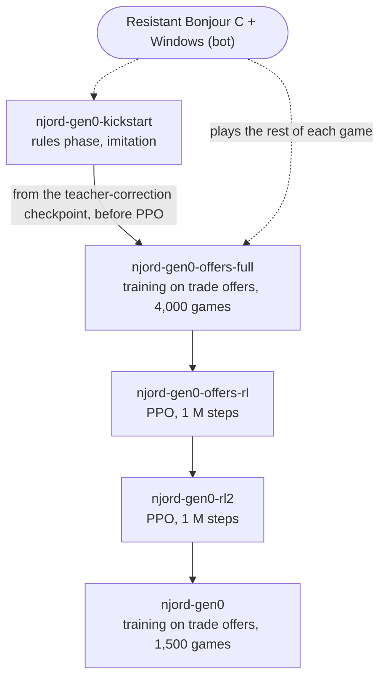
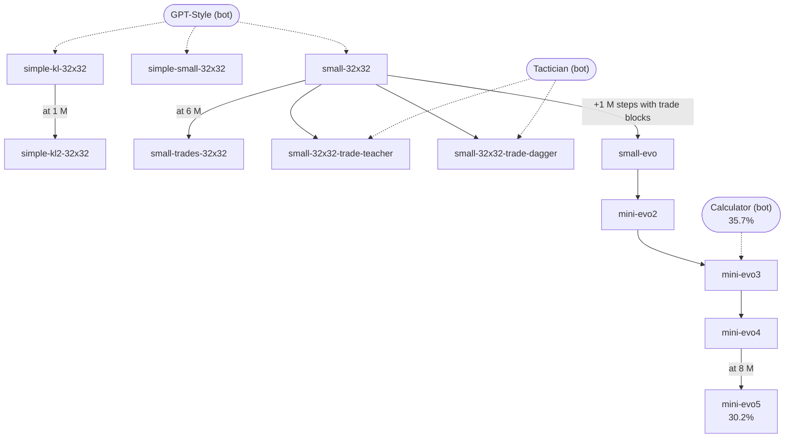

# Model lineage

Which of our models was trained from which, taken from the models' training configurations. This page grows with
every new model; the story behind each one is in the [research journal](journal/01-from-rule-bots-to-v7.md), and
every model is listed in the [glossary](glossary.md#models).

A solid arrow means that a model continued training from the weights of the previous one; a dotted arrow shows a
bot or model used as a teacher or to play out games during training. The edge label identifies its role where needed.
The [abandoned Loki branch](abandoned-models.md#abandoned-branch-loki)
is shown separately. The percentages are results in our main protocol (1,320
games; see [how we measure](journal/01-from-rule-bots-to-v7.md#1-the-question-and-how-we-measure)); where a number
comes from another evaluation, the text says so. Step counts restart with every run.

## Transformers

The story of these models is in [entry 3](journal/03-transformers-assemble.md); abandoned branches are in
[abandoned models](abandoned-models.md).

### njord-gen0 (6x128)

Our frontier model at the time of writing this document.

Training njord-gen0 involved experimenting with different approaches and dropping branches that performed worse than their predecessors. Its lineage is:

1. **njord-gen0-kickstart**. Rules phase (2,000 bot games, up to 10 epochs), imitation (1,500 games, up to 12 epochs)
  and 10 rounds of teacher correction, then PPO. "Resistant Bonjour C +
  Windows" is the teacher for imitation and teacher correction.
2. **njord-gen0-offers-full** (4,000 games). Learning to propose trades ("paired rollouts"): "Resistant Bonjour C +
  Windows" plays a game, and at the moment when it makes an accepted offer the model makes the offer instead and
  negotiates it itself; each moment is replayed eight times with the same dice and cards, once with the model's offer and
  once with the bot's own, and the whole network is trained on the difference in outcome. Rules are drawn at random in each game. It started
  from njord-gen0-kickstart's checkpoint, before any PPO (the solid arrow in the diagram).
3. **njord-gen0-offers-rl** (1.01 M steps). PPO from the end of njord-gen0-offers-full, against the 16-bot
  training pool, with no teachers and with rules drawn at random in training games (evaluation is always on the standard
  rules).
4. **njord-gen0-rl2** (1.01 M steps). PPO from the end of njord-gen0-offers-rl with the same settings and a
  small extra reward for cancelling drafts.
5. **njord-gen0** (1,500 games). Training on trade offers from the end of njord-gen0-rl2, in which
  njord-gen0-rl2 itself, not a bot, plays the rest of each game.

### Comparing network size and playing strength under the same training procedure

Models are trained with the same teacher, "Resistant Bonjour C + Windows", and the same procedure. Network architecture
is the experimental variable; each model generates its own experience during DAgger and PPO. Evaluation uses the same
set of bots, but individual games may have different seeds and dice rolls.

All transformers use the same "token per square" architecture, with 4 attention heads and SiLU. The feed-forward width
is 4 x the model width, following the original transformer paper. This ratio is fixed across the transformers;
their depth and width vary.

| Model | Type | Layers x width (MLP: hidden layers) | Feed-forward width | Parameters |
|---|---|---|---|---|
| ymir | transformer | 2 x 16 | 64 | 23,957 |
| hodr | transformer | 2 x 32 | 128 | 59,877 |
| vidar | transformer | 4 x 32 | 128 | 85,285 |
| ullr | transformer | 2 x 64 | 256 | 168,581 |
| forseti | transformer | 4 x 64 | 256 | 268,549 |
| hermod | transformer | 6 x 64 | 256 | 368,517 |
| baldr | transformer | 2 x 128 | 512 | 533,445 |
| vali | transformer | 4 x 128 | 512 | 929,989 |
| bragi | MLP | [80, 64] | - | 1,322,301 |
| freyr | transformer | 6 x 128 (same as network of njord-gen0) | 512 | 1,326,533 |
| tyr | transformer | 6 x 192 | 768 | 2,874,373 |
| odin | transformer | 8 x 256 | 1024 | 6,591,557 |
| heimdall | MLP | [1024, 512], on the unrolled observation of 16,166 numbers | - | 17,249,165 |

## MLPs: from the bots to mini-evo5

simple-small-32x32 and simple-kl-32x32 both started from their own imitation of "GPT-Style"; simple-kl2-32x32 is the
one that continued an earlier run.
