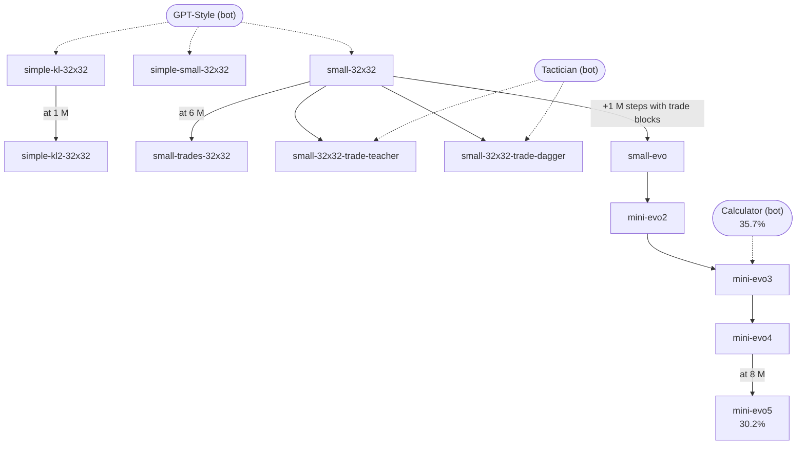
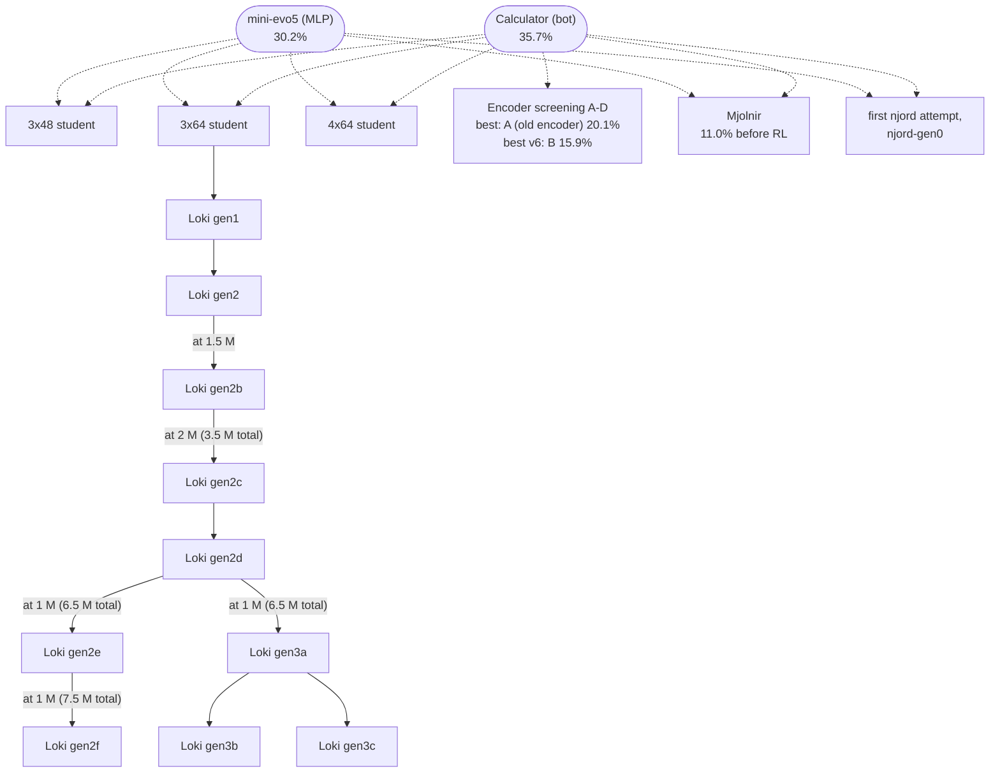

# Model lineage

Which of our models was trained from which, taken from the models' training configurations. This page grows with
every new model; the story behind each one is in the [research journal](journal/01-from-rule-bots-to-v7.md), and
every model is listed in the [glossary](glossary.md#models).

A solid arrow means that a model continued training from the weights of the previous one; a dotted arrow means that
it learned from a bot or a model by imitation or teacher correction. The percentages are results in our main
protocol (1,320 games; see [how we measure](journal/01-from-rule-bots-to-v7.md#1-the-question-and-how-we-measure)).
Step counts restart with every run; in the Loki series a checkpoint is given by its own steps, with the total since
the start of Loki gen2 in parentheses.

## MLPs: from the bots to mini-evo5

simple-small-32x32 and simple-kl-32x32 both started from their own imitation of "GPT-Style"; simple-kl2-32x32 is the
one that continued an earlier run.

## Transformers: from mini-evo5 and "Calculator" to njord

Several Loki runs also used "Calculator" as a trade teacher during RL, and Loki gen2f played against Loki gen2c and
Loki gen2d as rival models; njord-gen0 started from scratch, not from the first njord attempt. Those links are left
out of the diagram for clarity.
